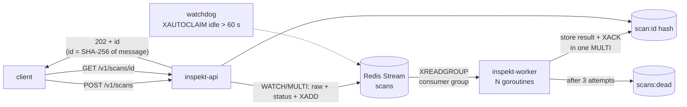
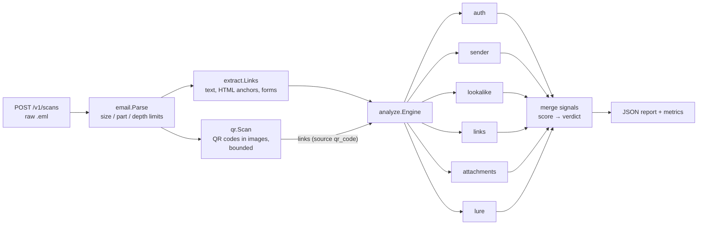

# Inspekt

An email threat-analysis service in Go. Inspekt parses raw messages, extracts
artifacts (links, forms, attachments), checks sender authentication and
identity, and returns an **explainable verdict**: every point of the score is
backed by a signal with evidence an analyst can read.

Detection quality is measured, not assumed: a Python evaluation harness reports
precision, recall and false-positive rate on labelled corpora, and CI fails if
a change makes detection worse.

```
$ inspekt scan testdata/phish_lookalike.eml
testdata/phish_lookalike.eml
  verdict: malicious (score 100)
  from:    alerts@micros0ft-support.com
  subject: Unusual sign-in activity
  links: 1  attachments: 0
  [high   +35] dmarc_fail: [dmarc=fail]
  [high   +35] link_text_mismatch: [shows "https://account.microsoft.com/security", goes to login-micros0ft.com]
  [high   +30] display_name_spoof: [display name shows security@microsoft.com, real sender is alerts@micros0ft-support.com]
  [high   +30] lookalike_sender: [micros0ft-support.com imitates microsoft.com (embedded)]
  [high   +30] lookalike_link: [login-micros0ft.com imitates microsoft.com (embedded)]
  [medium +20] reply_to_mismatch: [From micros0ft-support.com, replies go to gmail-recovery.net]
  ...
```

## Quick start

```bash
make test          # Go + Python tests
make scan          # scan the sample messages
make eval-sample   # precision / recall on the sample corpus
make run           # HTTP API on :8080, scans analysed inline (no Redis needed)
curl --data-binary @testdata/phish_lookalike.eml localhost:8080/v1/scans
make e2e           # full stack in Docker + end-to-end checks
```

With the full stack (`docker compose up --build`: API, Redis, worker), a scan
is queued and fetched by id:

```bash
$ curl -si --data-binary @testdata/phish_lookalike.eml localhost:8080/v1/scans
HTTP/1.1 202 Accepted
Location: /v1/scans/8f3c…
{"id":"8f3c…","status":"queued"}

$ curl -s localhost:8080/v1/scans/8f3c… | jq '.status, .report.verdict'
"done"
"malicious"
```

## Architecture

### Pipeline



- **Idempotent:** the same message posted twice is one scan.
- **At-least-once:** the entry is acknowledged in the same transaction that
  stores the result. A worker that dies mid-scan leaves the entry pending;
  the watchdog hands it to a live worker after 60 s.
- **Poison messages** (e.g. a parser panic) are dead-lettered with the
  reason after 3 attempts; unparseable input fails at once without retries.
- **Backpressure:** Redis runs with `maxmemory 64mb` and `noeviction`; when
  full, the API answers `503` with `Retry-After` instead of losing queued scans.
- **Graceful shutdown:** on SIGTERM the worker stops reading and finishes and
  acknowledges what it is analysing.
- `/readyz` checks Redis; `/metrics` adds queue lag, pending and dead-letter
  counts.

### Analysis



| Package | Responsibility |
|---|---|
| `internal/email` | Hostile-input MIME parser (stdlib only), limits, attachment hashing |
| `internal/extract` | Links with visible anchor text, form actions |
| `internal/analyze` | Independent checks, signal merging, scoring, verdict |
| `internal/qr` | QR codes in image attachments → links, with image count / size / pixel / time limits |
| `internal/auth` | Native SPF / DKIM / DMARC verification behind an injectable DNS `Resolver` |
| `internal/api` | HTTP API (async with a queue, inline without), Prometheus-format metrics |
| `internal/queue` | Redis Streams producer, worker pool, watchdog, dead-letter queue |
| `internal/config` | `INSPEKT_*` environment shared by CLI, API and worker |
| `eval/` | Precision / recall / FPR, false-positive drivers, CI quality gate |

## Design decisions

- **Every input is hostile.** The parser caps size, MIME part count and nesting
  depth, strips paths from attachment names, and is fuzz-tested in CI.
- **Explainability over a black box.** Checks emit signals with evidence;
  duplicate signals merge so ten copies of one bad link count once.
- **Forged headers are not evidence.** `Authentication-Results` is trusted only
  from configured authserv-ids, and `INSPEKT_AUTH_MODE=verify` ignores it
  entirely: Inspekt checks SPF, DKIM and DMARC (with alignment) against DNS
  itself. All DNS goes through an interface, so tests use a fake DNS.
- **An outage never looks like an attack.** DNS failures become `temperror`
  and an informational `auth_unverified` signal worth 0 points.
- **Wording rules carry little weight** (max 10 points). LLM-written phishing
  defeats keyword lists, so structural signals decide verdicts.
- **Thresholds change only with an eval run.**

## Detection quality

| Corpus | Messages | Precision | Recall | FPR |
|---|---|---|---|---|
| Sample (`testdata/`) | 7 | 1.00 | 0.80 | 0.00 |

The one miss is a deliberate, documented gap (see `testdata/labels.csv` and the
roadmap), and rules are not tuned to hide it: `bec_reply_to.eml` is a
text-only business-email compromise from a correctly authenticated domain,
whose only technical signal is a Reply-To mismatch.

`qr_phish.eml`, whose phishing URL exists only inside a QR code image, was
the second gap until QR decoding (step 4): recall went from 0.60 to 0.80, and
the gate was raised with it.

The sample gate (`--min-recall 0.8 --max-fpr 0 --max-parse-errors 0`) therefore
has no slack: losing any currently caught phish, flagging either legitimate
message, or failing to parse a sample fails CI.

## Known limitations

- Registrable domains use a small built-in suffix table instead of the full
  Public Suffix List.
- Authentication defaults to `INSPEKT_AUTH_MODE=headers` (read upstream
  `Authentication-Results`). `verify` mode checks DNS live, which is right for
  mail arriving now but wrong for archived corpora: their DKIM keys are often
  rotated out of DNS and their SPF records have changed, so old legitimate mail
  would fail. Evaluations on public corpora therefore run in `headers` mode.
- `verify` mode takes the client IP and HELO name from the **topmost**
  `Received` header and assumes our own MTA wrote it. Deploy Inspekt directly
  behind that MTA; headers further down can be forged and are never read.
- Scan results live in Redis for 24 h (MariaDB storage is step 5). Every
  worker restart leaves an idle consumer name in the group; harmless, but
  not cleaned up yet.
- A transiently failed scan is retried only when the watchdog reclaims it,
  so a retry takes about 60 s.
- Redis checks `maxmemory` before each write, so one write can overshoot it
  by up to a full message (25 MiB). The Redis container's memory limit
  (160 MiB) leaves room for that.
- DMARC `pct=` is ignored and the policy is reported, not enforced.
- `dmarc_fail` scores 35 regardless of the domain's policy. A domain with
  `p=none` (gmail.com, for one) has not asked receivers to act on failures,
  and forwarding legitimately breaks DMARC, so this may over-weight it. The
  weight stays until the public-corpus evaluation (step 7) can measure it.
- HTML and archive attachments are flagged by type, not opened.
- QR codes are read from PNG, JPEG and GIF attachments only: not from images
  embedded as `data:` URIs in HTML, inside PDFs or Office files, and only
  one QR code per image. Images beyond the limits (10 per message, 5 MiB,
  4000×4000 px, 2 s each) are skipped with a 0-point `qr_not_scanned` signal.
  A decode that times out keeps running in the background until it ends;
  the pixel limit bounds that cost.

## Roadmap

See [`docs/WEEKEND_PLAN.md`](docs/WEEKEND_PLAN.md): native SPF/DKIM/DMARC,
Redis Streams worker pipeline with watchdog and dead-letter queue, QR-code
decoding, MariaDB storage, grey-zone LLM classifier for BEC, evaluation on
public corpora, Grafana dashboards and benchmarks.

## License

MIT
