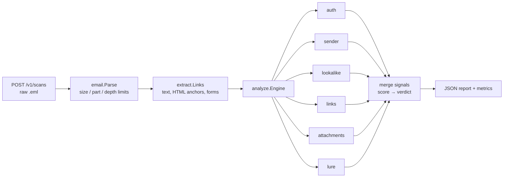

# Inspekt

An email threat-analysis service in Go. Inspekt parses raw messages, extracts
artifacts (links, forms, attachments), checks sender authentication and
identity, and returns an **explainable verdict**: every point of the score is
backed by a signal with evidence an analyst can read.

Detection quality is measured, not assumed: a Python evaluation harness reports
precision, recall and false-positive rate on labelled corpora, and CI fails if
a change makes detection worse.

```
$ inspekt scan testdata/phish_lookalike.eml
testdata/phish_lookalike.eml
  verdict: malicious (score 100)
  from:    alerts@micros0ft-support.com
  subject: Unusual sign-in activity
  links: 1  attachments: 0
  [high   +35] dmarc_fail: [dmarc=fail]
  [high   +35] link_text_mismatch: [shows "https://account.microsoft.com/security", goes to login-micros0ft.com]
  [high   +30] display_name_spoof: [display name shows security@microsoft.com, real sender is alerts@micros0ft-support.com]
  [high   +30] lookalike_sender: [micros0ft-support.com imitates microsoft.com (embedded)]
  [high   +30] lookalike_link: [login-micros0ft.com imitates microsoft.com (embedded)]
  [medium +20] reply_to_mismatch: [From micros0ft-support.com, replies go to gmail-recovery.net]
  ...
```

## Quick start

```bash
make test          # Go + Python tests
make scan          # scan the sample messages
make eval-sample   # precision / recall on the sample corpus
make run           # HTTP API on :8080
curl --data-binary @testdata/phish_lookalike.eml localhost:8080/v1/scans
docker compose up --build
```

## Architecture



| Package | Responsibility |
|---|---|
| `internal/email` | Hostile-input MIME parser (stdlib only), limits, attachment hashing |
| `internal/extract` | Links with visible anchor text, form actions |
| `internal/analyze` | Independent checks, signal merging, scoring, verdict |
| `internal/api` | HTTP API, Prometheus-format metrics |
| `eval/` | Precision / recall / FPR, false-positive drivers, CI quality gate |

## Design decisions

- **Every input is hostile.** The parser caps size, MIME part count and nesting
  depth, strips paths from attachment names, and is fuzz-tested in CI.
- **Explainability over a black box.** Checks emit signals with evidence;
  duplicate signals merge so ten copies of one bad link count once.
- **Forged headers are not evidence.** `Authentication-Results` is trusted only
  from configured authserv-ids.
- **Wording rules carry little weight** (max 10 points). LLM-written phishing
  defeats keyword lists, so structural signals decide verdicts.
- **Thresholds change only with an eval run.**

## Detection quality

| Corpus | Messages | Precision | Recall | FPR |
|---|---|---|---|---|
| Sample (`testdata/`) | 4 | 1.00 | 0.67 | 0.00 |

The missed sample is a text-only business-email-compromise message from a
correctly authenticated domain: it has no technical signal beyond a Reply-To
mismatch. That gap is deliberate and documented; see the roadmap.

## Known limitations

- Registrable domains use a small built-in suffix table instead of the full
  Public Suffix List.
- Authentication is read from upstream headers; native SPF/DKIM/DMARC
  verification is on the roadmap.
- HTML and archive attachments are flagged by type, not opened.

## Roadmap

See [`docs/WEEKEND_PLAN.md`](docs/WEEKEND_PLAN.md): native SPF/DKIM/DMARC,
Redis Streams worker pipeline with watchdog and dead-letter queue, QR-code
decoding, MariaDB storage, grey-zone LLM classifier for BEC, evaluation on
public corpora, Grafana dashboards and benchmarks.

## License

MIT
