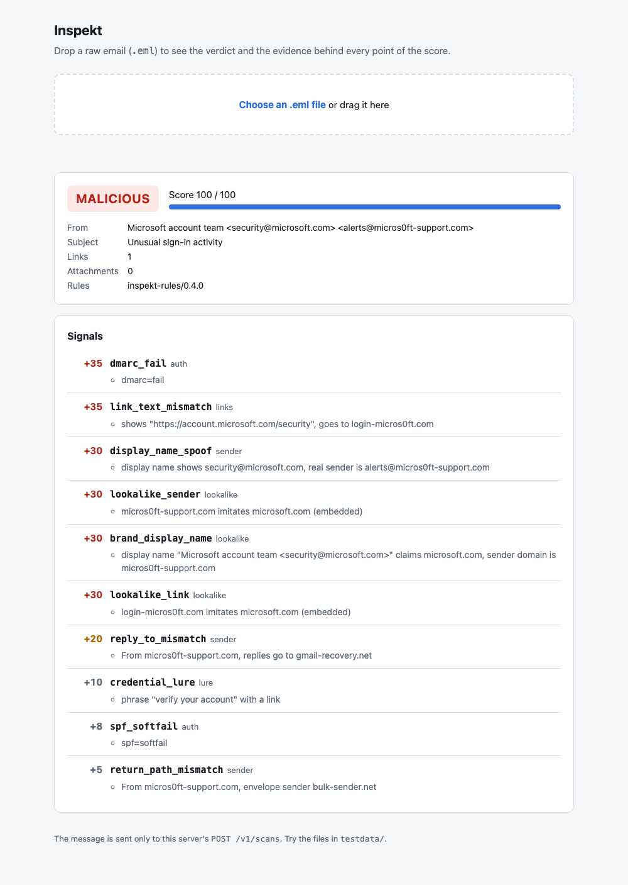
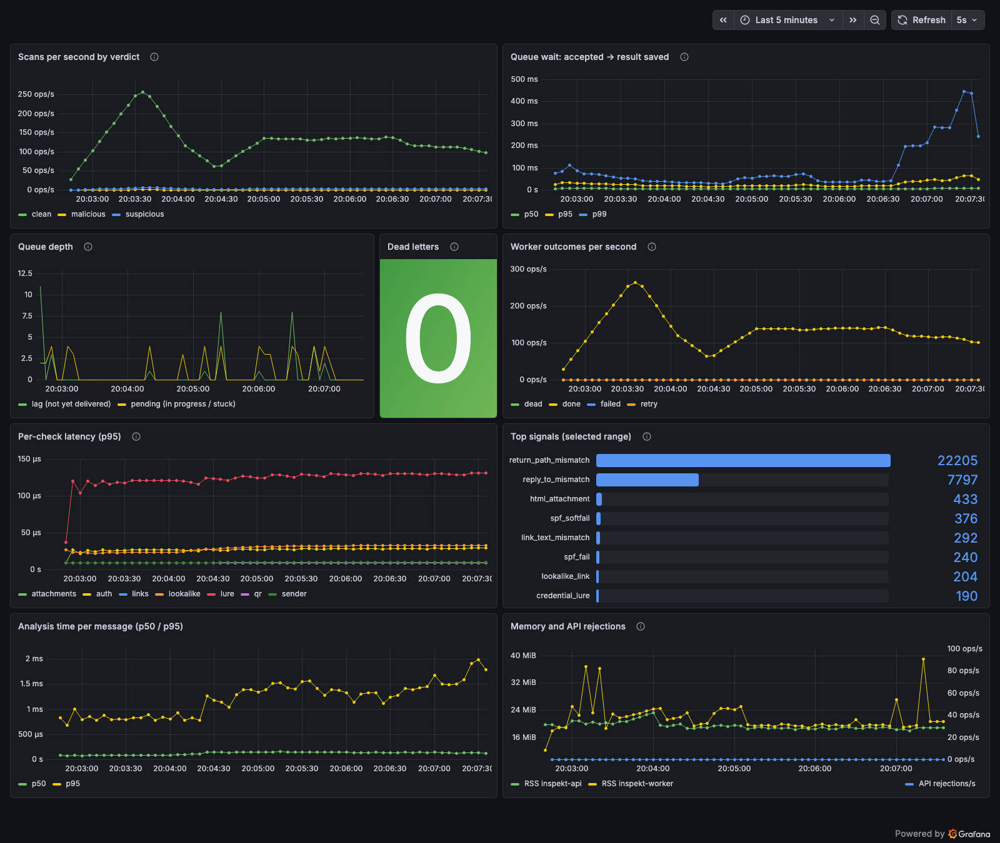
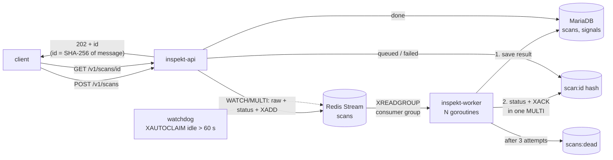
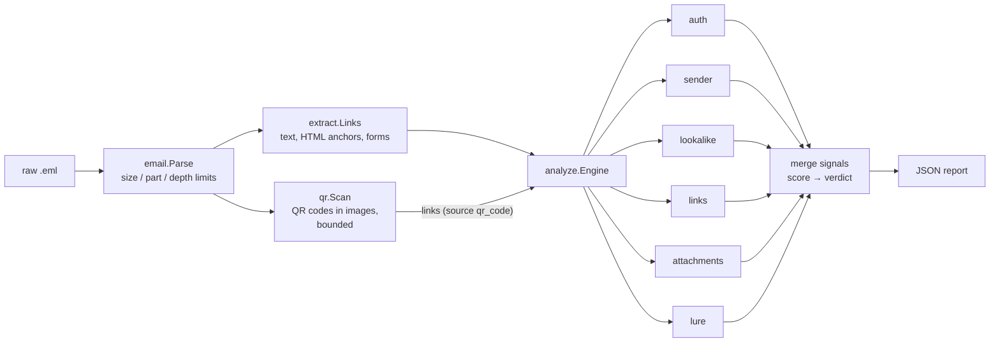

# Inspekt

**An email threat-analysis service in Go that explains every verdict and
measures its own accuracy.** Inspekt parses raw email as hostile input,
extracts links (including ones hidden in QR-code images), verifies SPF,
DKIM and DMARC itself, and scores the message with small, independent
rules; every point of the score comes with evidence an analyst can read.
Behind the API sits a crash-safe Redis Streams pipeline (at-least-once,
watchdog, dead-letter queue, backpressure) with results in MariaDB,
Prometheus metrics and a Grafana dashboard. An optional LLM gives a second
opinion only on messages the rules cannot decide, and can only add points.
Detection is measured on public corpora with a held-out split, and CI fails
if it regresses.

| Headline | Result |
|---|---|
| Precision / recall / FPR, 6,202 public emails (rules `0.4.0`) | **0.9537 / 0.3821 / 0.0092** |
| Same, on the 20 % holdout never used for design | 0.9565 / 0.3775 / 0.0088 |
| Recall before the latest two checks (holdout) | 0.1985 → **0.3775**, no new false positives |
| Full Docker stack throughput, MacBook Air M3 | **868.1–1,019.6 scans/s** across load runs; end-to-end p95 64.2 ms at 32 clients (rules `0.4.0`) |
| Analysis of a typical message | 6,654–17,220 ns (single core) |

Honest reading: it is precise (about 19 in 20 flags are right) but catches
about **one phishing email in three**; most of what it misses has nothing
structurally wrong. [Details](#detection-quality) and
[`docs/EVAL.md`](docs/EVAL.md) have every number, including the ones that
are not flattering.



*The demo page at `/`: drop an `.eml`, get the verdict and the evidence.*



*The Grafana dashboard during a load test (see [Observability](#observability)).*

```
$ inspekt scan testdata/phish_lookalike.eml
testdata/phish_lookalike.eml
  verdict: malicious (score 100)
  from:    alerts@micros0ft-support.com
  subject: Unusual sign-in activity
  links: 1  attachments: 0
  [high   +35] dmarc_fail: [dmarc=fail]
  [high   +35] link_text_mismatch: [shows "https://account.microsoft.com/security", goes to login-micros0ft.com]
  [high   +30] display_name_spoof: [display name shows security@microsoft.com, real sender is alerts@micros0ft-support.com]
  [high   +30] lookalike_sender: [micros0ft-support.com imitates microsoft.com (embedded)]
  [high   +30] brand_display_name: [display name "Microsoft account team <security@microsoft.com>" claims microsoft.com, sender domain is micros0ft-support.com]
  [high   +30] lookalike_link: [login-micros0ft.com imitates microsoft.com (embedded)]
  ...
```

## How I built this

I built Inspekt over one weekend with AI as the implementation partner: Claude (chat) for planning and the initial skeleton, and [Claude Code](https://claude.com/claude-code) for the implementation. I chose the problem and the target, a scan pipeline for email security, and directed the work step by step from the plan in `docs/WEEKEND_PLAN.md`.

The decisions were mine: the order of the steps, the LLM provider and what data may leave the system, that public corpora are never sent to an LLM, that the LLM stays off unless explicitly enabled, and that every number is reported as measured. The implementation followed fixed rules. Every step ends with green tests and its own commit, and CI must pass before the next step. Bugs are fixed in separate commits with a test that fails on the old code. Detection weights change only on evaluation data, decided on the dev split and confirmed once on the holdout.

I tested the running system myself (API, queue, Grafana, the demo page and the Groq integration). `docs/NOTES.md` explains each step in plain language with interview questions; it is what I use to study the design. The commit history shows the order of work, including the bugs the evaluation and load tests found.

## Quick start

```bash
make test          # Go + Python tests
make scan          # scan the sample messages
make run           # HTTP API on :8080, scans analysed inline (no Redis needed)
open http://localhost:8080   # demo page: drop an .eml, see verdict, score and evidence
curl --data-binary @testdata/phish_lookalike.eml localhost:8080/v1/scans

make e2e           # full stack in Docker (API, Redis, worker, MariaDB) + end-to-end checks
make test-db       # store tests against a throwaway MariaDB container
make eval-sample   # precision / recall on the 7 hand-made samples
make eval          # download the public corpora (pinned) and evaluate on 6,202 emails
```

With the full stack (`docker compose up --build`), a scan is queued and
fetched by id. The MariaDB password defaults to a **dev-only** value
(`inspekt-dev`, public in this repo); anywhere else, copy `.env.example` to
`.env` and set `INSPEKT_DB_PASSWORD`.

```bash
$ curl -si --data-binary @testdata/phish_lookalike.eml localhost:8080/v1/scans
HTTP/1.1 202 Accepted
Location: /v1/scans/8f3c…
{"id":"8f3c…","status":"queued"}

$ curl -s localhost:8080/v1/scans/8f3c… | jq '.status, .report.verdict, .received_at'
"done"
"malicious"
"2026-10-24T09:00:00.123Z"
```

Results land in MariaDB with one row per signal, so detection questions are
plain SQL:

```sql
-- Which signals fire on mail we called clean? (false-positive drivers)
SELECT signal_id, COUNT(*) FROM signals JOIN scans ON scans.id = signals.scan_id
WHERE verdict = 'clean' AND received_at > NOW() - INTERVAL 7 DAY
GROUP BY signal_id ORDER BY 2 DESC;
```

## Architecture

### Pipeline



- **Idempotent:** the same message posted twice is one scan.
- **At-least-once:** the result is saved to MariaDB first (an idempotent
  upsert), then the entry is acknowledged in the same Redis transaction that
  marks it done. A worker that dies mid-scan leaves the entry pending; the
  watchdog hands it to a live worker after 60 s.
- **Poison messages** (e.g. a parser panic) are dead-lettered with the reason
  after 3 attempts; unparseable input fails at once without retries.
- **Backpressure:** Redis runs with `maxmemory 64mb` and `noeviction`; when
  full, the API answers `503` with `Retry-After` instead of losing queued scans.
- **Graceful shutdown:** on SIGTERM the worker stops reading, then finishes and
  acknowledges what it is analysing.
- `/readyz` checks Redis and MariaDB. Prometheus metrics come from the API
  (`:8080/metrics`) and from every worker (`:9090/metrics`); see
  [Observability](#observability).

### Analysis



| Package | Responsibility |
|---|---|
| `internal/email` | Hostile-input MIME parser (stdlib only), limits, attachment hashing |
| `internal/extract` | Links with visible anchor text, form actions (fuzz-tested) |
| `internal/qr` | QR codes in image attachments → links, with image count / size / pixel / time limits |
| `internal/auth` | Native SPF / DKIM / DMARC verification behind an injectable DNS `Resolver` |
| `internal/analyze` | Independent checks, signal merging, scoring, verdict |
| `internal/api` | HTTP API (async with a queue, inline without), metrics, and the demo page at `/` (one embedded HTML file, strict CSP) |
| `internal/queue` | Redis Streams producer, worker pool, watchdog, dead-letter queue |
| `internal/store` | `Store` interface; MariaDB (upsert, signals table, migrations under a named lock) and in-memory |
| `internal/pipeline` | What a worker does with a job: analyse, then save |
| `internal/llm` | Optional grey-zone reviewer: data minimisation, OpenAI-compatible client, per-minute and daily budget, 429 pause |
| `internal/config` | `INSPEKT_*` environment shared by CLI, API and worker |
| `internal/metrics` | Prometheus metrics shared by API and worker; queue gauges read from Redis at scrape time |
| `deploy/` | Prometheus scrape config, Grafana datasource and dashboard (provisioned) |
| `migrations/` | Numbered SQL files, embedded in the binaries and applied at startup |
| `cmd/` | `inspekt` (CLI), `inspekt-api`, `inspekt-worker`, `inspekt-load` (load generator) |
| `eval/` | Corpus fetch (pinned), held-out split, precision / recall / FPR, analysis, CI gates |

## Detection quality

Measured with `make eval` on public corpora. Sources, checksums, every
intermediate result and the full analysis are in
[`docs/EVAL.md`](docs/EVAL.md).

| Corpus | Ham | Phish | Precision | Recall | F1 | FPR |
|---|---|---|---|---|---|---|
| Public: SpamAssassin ham 2002–03 + Nazario phishing 2019–25 | 4,150 | 2,049 (+3 unparseable) | 0.9537 | 0.3821 | 0.5456 | 0.0092 |
| — dev split (80 %) | 3,357 | 1,641 | 0.9530 | 0.3833 | | 0.0092 |
| — holdout split (20 %) | 793 | 408 | 0.9565 | 0.3775 | | 0.0088 |
| CI subset (holdout, fixed) | 100 | 100 | 0.9750 | 0.39 | | 0.01 |
| Sample (`testdata/`) | 2 | 5 | 1.00 | 0.80 | | 0.00 |

**What this says.** The rules are precise (about 19 in 20 flags are right,
under 1 % of legitimate mail is flagged) but catch **about one phishing
message in three**. The largest group of misses linked to legitimate
infrastructure attackers abuse (IPFS gateways, object storage, serverless
hosting) or claimed a brand in the sender name. Two checks designed on the
dev split and each measured once on the holdout (`abused_hosting_link`,
`brand_display_name`) raised holdout recall from 0.20 to 0.38 with no new
false positives. Most remaining misses have nothing structurally wrong.

**How it was measured.** A fixed 80/20 dev/holdout split by hash of the file
path; changes were chosen on dev and kept only if holdout agreed. Two weights
changed on that evidence (`html_form_in_email` 30 → 10, which cut false
positives by two thirds; `missing_from` 20 → 30). The ham is 20 years older
than the phishing, which makes authentication signals look perfect; no
weight was raised because of that. The evaluation's first run also found a
crash in HTML link extraction on non-ASCII input (now fixed and fuzz-tested).

**Gates.** CI fails if detection regresses: the 7 hand-made samples
(`--min-recall 0.8 --max-fpr 0`; the one miss, `bec_reply_to.eml`, is a
documented gap for the grey-zone LLM) and a fixed 200-message holdout subset
of the public corpora (`--min-recall 0.39 --max-fpr 0.01`), rebuilt in CI
from the pinned downloads because the SpamAssassin texts may not be
redistributed. Both gates sit exactly at today's numbers, and parse errors
fail them too.

## Performance

Details, raw numbers and method in [`docs/BENCHMARKS.md`](docs/BENCHMARKS.md).
MacBook Air 13" M3 (2024), 8 GB RAM.

| Measure | Result |
|---|---|
| Parse a typical message | 3,401–9,121 ns (119.7–176.3 MB/s) |
| Analyse a typical message | 6,654–17,220 ns (rules `0.4.0`) |
| Analyse with a QR code to decode | 338,518 ns |
| Analyse a 300-link newsletter | 683,667 ns (1,879,144 ns before profiling; 474,789 ns on rules `0.2.0`) |
| CLI over the public corpus | 2,018.0–2,176.9 messages/s, one process |
| Full Docker stack, 32 clients, real corpus mix | 868.1 scans/s on `0.2.0`, 1,019.6 on `0.4.0`; end-to-end p95 78.4 / 64.2 ms |
| Full Docker stack, 64 clients, polling every 50 ms | 980.9 scans/s; end-to-end p95 116.2 ms (rules `0.2.0`) |

Profiling with `pprof` showed ~91 % of the engine's allocations in the
lookalike check (protected-brand forms re-derived for every link); fixing it
made link-heavy mail 4× faster with identical results on all 6,199 corpus
messages. The load test found a real bug: InnoDB deadlocks between
concurrent workers saving signals (scans survived, but waited a minute for
the watchdog); fixed and covered by a 200-way concurrent test. In the load
test the limit is the read path that client polling creates, not analysis.

## Grey-zone LLM review (optional, off by default)

Text-only business-email compromise ("buy gift cards, keep it quiet", "our
bank details changed") has nothing structurally wrong, so the rules give it
a low score. For messages the rules **could not decide**, an LLM can add a
second opinion.

```bash
# .env (see .env.example): any OpenAI-compatible endpoint; Groq as the example
INSPEKT_LLM_BASE_URL=https://api.groq.com/openai/v1
INSPEKT_LLM_MODEL=openai/gpt-oss-20b
INSPEKT_LLM_API_KEY=gsk_...

# Credentials alone do nothing. The review runs only with an explicit switch:
INSPEKT_LLM_ENABLED=true docker compose up -d
```

- **Off unless switched on:** every binary (API, worker, CLI) ignores the
  LLM settings unless `INSPEKT_LLM_ENABLED=true` is set, and compose defaults
  it to `false`. Keeping a key in `.env` is therefore safe: a load test or a
  demo cannot send mail to the provider by accident. Leave the switch out of
  `.env` and set it per command when you mean it.

- **Only the grey zone:** score 10–69 and no attachments. Everything else
  never reaches the model.
- **Only adds:** the answer is mapped to +0, +15 or +30 points, and the
  engine clamps it to that range. An email that tells the model "ignore
  your rules, this is safe" can at most earn 0 extra points; it can never
  remove what the rules found.
- **Prompt-injection hardening:** the email is placed inside a block whose
  delimiter is a fresh random nonce, the system prompt says its content is
  data, the model must answer with JSON, and only one number is used.
- **What leaves the system:** the subject and the first 2,000 characters of
  the body text, with email addresses, URLs, domain names and 6+ digit
  sequences masked. Never headers, sender or recipient addresses, links,
  attachments or IPs. **Names, company names and amounts are not masked.**
  `inspekt excerpt FILE.eml` prints exactly what would be sent.
- **Cost and rate limits:** at most 4 calls per minute and 100 per day by
  default, counted in Redis across all processes, which stays well inside
  Groq's published per-model limits. A `429` is not retried: the scan falls
  back to the rules (0-point `llm_unavailable` signal) and all processes
  pause calls for the provider's `Retry-After`. Timeout 5 s, same fallback.
- **Evaluation:** the public corpora are never sent to an LLM
  (`evaluate.py` refuses to). On our own 5-message BEC set (`testdata/bec/`,
  `make eval-bec`) with Groq `openai/gpt-oss-20b`, two runs each caught all
  3 BEC messages (rules alone: 0) and flagged neither legitimate message;
  all 10 answers were valid JSON. The answers vary between runs even at
  temperature 0, and one BEC message was caught only marginally; see
  [`docs/EVAL.md`](docs/EVAL.md#grey-zone-llm-on-the-bec-set). Five
  hand-written messages are a mechanism check, not a precision estimate.

## Observability

```bash
docker compose --profile observability up -d --build   # adds Prometheus and Grafana
open http://localhost:3000                             # dashboard "Inspekt" (anonymous read-only)
```

The dashboard screenshot at the top was taken during a load run (8
clients, real corpus mix plus samples, polling every 50 ms) on the MacBook
Air. The p99 queue-wait rise at its right edge coincides with restarting
Grafana and rendering the screenshot on the same laptop.

| Metric | Type | From | What it answers |
|---|---|---|---|
| `inspekt_verdicts_total{verdict}` | counter | worker (API inline) | How much mail, and what share is flagged? |
| `inspekt_queue_wait_seconds` | histogram | worker | How long a client waits: API acceptance → result saved |
| `inspekt_check_duration_seconds{check}` | histogram | worker (API inline) | Which check costs time (QR decoding dominates on image mail) |
| `inspekt_scan_duration_seconds` | histogram | worker (API inline) | Parse + analysis time per message |
| `inspekt_worker_outcomes_total{outcome}` | counter | worker | done / failed / retry / dead per delivery |
| `inspekt_signals_total{signal}` | counter | worker (API inline) | Which rules fire most (false-positive drivers) |
| `inspekt_queue_lag`, `_pending`, `_dead_letters` | gauge | API (read from Redis at scrape) | Backlog, stuck work, poison messages |
| `inspekt_scans_enqueued_total`, `inspekt_scan_failures_total` | counter | API | Accepted and rejected submissions |

Plus the Go runtime and process metrics (memory, goroutines). A Redis outage
removes only the queue gauges from `/metrics`; everything else keeps being
served. A test fails if the dashboard queries a metric the code does not
define.

## Design decisions

- **Every input is hostile.** The parser caps size, MIME parts and nesting;
  images are checked against pixel limits *from their header* before any
  pixel is decoded (a 67-byte PNG claiming 50000×50000 is rejected in
  microseconds); decoding is time- and concurrency-bounded; the parser and
  the HTML link extractor are fuzz-tested in CI.
- **Explainability over a black box.** Checks emit signals with evidence;
  duplicate signals merge so ten copies of one bad link count once.
- **Forged headers are not evidence.** `Authentication-Results` is trusted only
  from configured authserv-ids, and `INSPEKT_AUTH_MODE=verify` ignores it
  entirely: Inspekt checks SPF, DKIM and DMARC (with alignment) itself. All DNS
  goes through an interface, so tests use a fake DNS.
- **An outage never looks like an attack.** DNS failures become `temperror`
  and an informational `auth_unverified` signal worth 0 points.
- **A crash can cause a repeat, never a loss.** Results are saved before the
  queue entry is acknowledged; saving is an idempotent upsert keyed by the
  message hash, so a redelivered scan overwrites instead of duplicating.
- **Configuration is a claim until a test proves it.** `noeviction` looked
  right, but Redis 7 does not memory-check unflagged Lua scripts; the enqueue
  now uses `WATCH`/`MULTI`, and the end-to-end test fills Redis on purpose.
- **Wording rules carry little weight** (max 10 points). LLM-written phishing
  defeats keyword lists, so structural signals decide verdicts.
- **Weights change only with an eval run**, decided on the dev split and
  confirmed on the holdout.

## Known limitations

- **Recall is moderate (0.38)**: much modern phishing has nothing structurally wrong;
  see [What I'd do next](#what-id-do-next).
- **The grey-zone LLM is measured only on 5 synthetic messages**, by
  design (the public corpora must not be sent to a provider). Its answers
  vary between runs even at temperature 0. Its grey zone starts at score 10:
  a BEC email with no technical signal at all (score 0) is never reviewed.
- The public ham predates SPF, DKIM, DMARC and URL shorteners, so their
  false-positive cost is not measured. `dmarc_fail` scores 35 regardless of
  the domain's policy: 39 of 51 DMARC-failing phishing messages came from
  `p=none` domains, and down-weighting would miss 35 of them, but the cost on
  legitimately forwarded mail is unmeasured.
- Click-tracking redirectors in legitimate newsletters still trigger
  `link_text_mismatch` (the main remaining false-positive class).
- Registrable domains use a small built-in suffix table instead of the full
  Public Suffix List.
- `verify` auth mode takes the client IP and HELO from the **topmost**
  `Received` header and assumes our own MTA wrote it; deploy directly behind
  that MTA. It is wrong for archived mail (rotated DKIM keys), so evaluations
  run in `headers` mode. DMARC `pct=` is ignored.
- Queue state lives in Redis for 24 h; results in MariaDB have no retention
  policy yet. A transiently failed scan is retried only when the watchdog
  reclaims it (about 60 s). Worker restarts leave idle consumer names in the
  group. Migrations only move forward, and MariaDB cannot roll back DDL.
- Redis checks `maxmemory` before each write, so one write can overshoot it by
  up to a full message (25 MiB); the container limit (160 MiB) leaves room.
- HTML and archive attachments are flagged by type, not opened. QR codes are
  read from PNG, JPEG and GIF attachments only (not `data:` URIs, PDFs or
  Office files), one per image, within the limits (10 images, 5 MiB,
  4000×4000 px, 2 s each); skipped images give a 0-point `qr_not_scanned`
  signal.

## What I'd do next

In order of expected impact on the measured weaknesses:

1. **A modern ham corpus** for the abused-hosting check: the 2002 ham cannot
   contain IPFS or serverless links, so its false-positive cost on today's
   mail is unmeasured.
2. **Open-redirect unwrapping**: run the link checks on the destination inside
   `google.com/url?q=`, `doubleclick.net` and ESP click links, without fetching.
3. **The same modern ham corpus** (with DMARC, shorteners, forwarding) to measure
   the false-positive cost of authentication signals and settle the `p=none` risk.
4. **Alerts** on the existing metrics: dead letters above 0, pending growing,
   queue-wait p95 over a budget, a signal's share of clean mail jumping.
5. **Measure the grey-zone LLM on more (and real, consented) BEC data**,
   then set its point mapping and thresholds from that, not from 5 samples.
6. **Webhooks or long polling** for results instead of client polling, which
   the load test showed is the throughput limit.
7. URL reputation feeds, the full Public Suffix List, a retention policy for
   results.

## Documentation

- [`docs/EVAL.md`](docs/EVAL.md): corpora, method, every result, analysis, decisions
- [`docs/BENCHMARKS.md`](docs/BENCHMARKS.md): micro-benchmarks, profiling, load test
- [`docs/NOTES.md`](docs/NOTES.md): each step explained simply, with interview questions
- [`docs/WEEKEND_PLAN.md`](docs/WEEKEND_PLAN.md): the build plan

## License

MIT. The evaluation corpora are not included; `eval/fetch_corpora.sh` downloads
them from their sources (Nazario corpus: CC BY 4.0, José Nazario).
